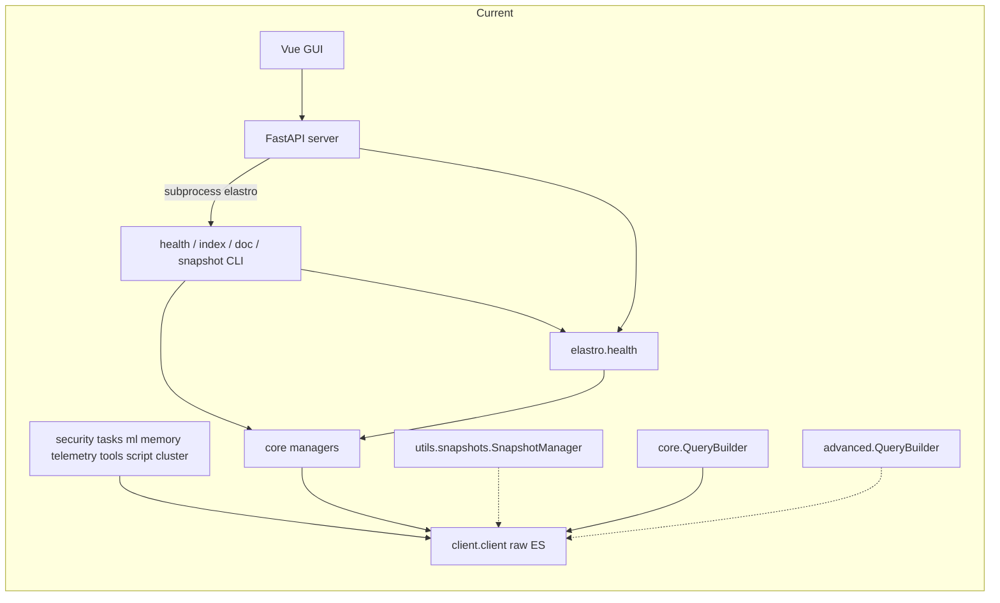
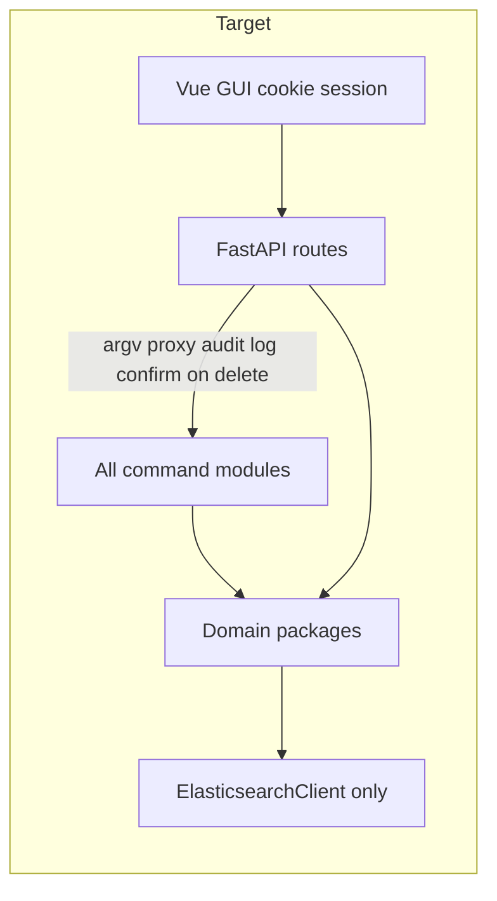

# Elastro Engineering Report Card and Uplift Specification

| Field | Value |
|---|---|
| Author | Elastro Engineering |
| Date | 2026-11-19 |
| Status | Draft |
| Scope | Engineering quality of the `elastro` tree at version **1.13.4** (`pyproject.toml`). Not a product feature spec. |
| Bar | SpaceX engineering principles (explicit requirements, delete unused parts, tight feedback, own the operational outcome, one responsibility per module, partial failure is a requirement) plus the FAANG CLI/platform bar already written in `.grok/skills/elastro-python-faang/SKILL.md` and `.grok/skills/elastro-logging/SKILL.md`. |
| Evidence rule | Code wins over docs. Counts below are from a direct scan of this tree on 2026-11-19, not from the README. |

## Overview

Elastro is a Python 3.10–3.13 Elasticsearch operations library and `rich-click` CLI (`elastro = elastro.cli.cli:main`) plus a localhost Vue 3 GUI served by FastAPI (`elastro/server`). The package is about **28,294 lines** of Python under `elastro/` (**154** modules) and **927** `def test_` functions across **91** `test_*.py` files (count: walk `tests/` and match `^\s*def test_`).

The health domain is already close to the bar the repo claims. `elastro/health/` is **8,954** lines (~32% of package Python), with Pydantic models, a remediation catalog, dry-run, rollback snapshots, an exit-code policy, and audit logging. The rest of the CLI does not follow that pattern. Twenty-three of twenty-four command modules never call `get_logger`. Several operational commands call `client.client.*` directly. `security.py`, `tasks.py`, `ml.py`, `cluster.py`, `script.py`, and `painless_commands.py` print failures with Rich on **stdout** and return normally, so Click exits **0**. `tools.py`, `telemetry.py`, and `memory.py` already call `sys.exit(1)`; `snapshot.py`, `rag.py`, and the template wizard print errors with Rich and then `exit(1)` (the wizard's deploy `except` at `template.py` does not). The GUI health route can execute destructive fixes because `RemediationExecutor._should_execute` returns true when `api_mode` is set, and `HealthPanel.vue` posts `dry_run: false`. A second route, `POST /api/clusters/{name}/indices/{index}/fix`, does the same; `ClusterDetail.vue` posts `{ action }` only, so that button is an accidental dry-run today (`IndexFixRequestSchema.dry_run` defaults true) and still drops the row.

This document grades the current tree and specifies an incremental program — **13 reviewable PRs** — that raises the long tail to the health domain's standard without a rewrite.

## Report Card

Grades are for the tree as it runs today. "A" means the dimension meets the written bar on the paths operators actually use, not that a subsystem is perfect.

| Dimension | Grade | Evidence | Gap vs bar |
|---|---|---|---|
| Architecture and layering | **C+** | Health is CLI → `HealthAssessor` / `RemediationCatalog` → collectors and `IndexManager` → `ElasticsearchClient`. `document.py` uses `DocumentManager`; `snapshot.py` uses `elastro.core.snapshot.SnapshotManager`. `security.py`, `tasks.py`, `ml.py`, `memory.py`, `telemetry.py`, `tools.py`, and `script.py` call `client.client` (or `perform_request`) from the Click function. Two unrelated `QueryBuilder` classes: `elastro/core/query_builder.py` (CLI string parser, used by `document.py` and `daemon.py`) and `elastro/advanced/query_builder.py` (fluent DSL). Two `SnapshotManager` classes: `elastro/core/snapshot.py` (CLI and health) and `elastro/utils/snapshots.py` (still exported from `elastro/utils/__init__.py`). | Skill forbids CLI → raw `es.*` except legacy paths being migrated. The legacy set is still the majority of command families. Do not invent a universal resource base class; delete the duplicate names. |
| Requirements and failure contracts | **C+** | `elastro/health/exit_policy.py` `FailOn` and `resolve_exit_code` / `resolve_fix_exit_code` are testable. `health.py` raises `SystemExit` from those helpers (operational failure → 1, degraded → 2). Do not cite a combined token count of `SystemExit` plus `resolve_exit_code`. `security.py` `list_users`, `tasks.py` `list_tasks` / `cancel_task`, `ml.py` `init_job`, and `cluster.py` `explain_allocation` / `cluster_settings` catch `Exception`, `console.print` the error, and do not exit. `script.py` and `painless_commands.py` do the same. `cli()` in `elastro/cli/cli.py` catches connect failures and `pass`es (lines 186–196). The comment names `config`. `gui()` and `daemon start` also take no `@click.pass_obj` and do not read `ctx.obj`, so they depend on that `pass`. `datastream.py`, `ilm.py`, `utils.py`, `index.py`, `document.py`, and `template.py` (except the wizard deploy `except`) already `exit(1)` after `click.echo(..., err=True)`. | A failed RBAC listing or a down cluster is not a failed process for the exit-0 set. Rich `Console()` writes to stdout, so error text contaminates piped output even when `exit(1)` is present (`snapshot.py`, `rag.py`). Health's 0 / 1 / 2 contract is the one to copy. |
| Testing and feedback loops | **C+** | **927** tests / **91** files. Health: **181** tests in **37** unit files plus **62** tests in **10** `tests/integration/test_health_*.py` files. Core unit tests are real (**440** in **19** files) and use `es_client` mocks from `tests/conftest.py`. CLI unit tests: **10** functions in **2** files (`test_daemon.py`, `test_deletion_dry_run.py`). Server unit tests: **9** functions in **3** files. No test references `security_group`, `tasks_group`, `ml_group`, `telemetry_group`, or `memory_group`. CI (`.github/workflows/ci.yml`) runs health tests and `tests/unit/{core,config,cli,server,advanced}` on Python **3.12 only**. It does not run `tests/unit/utils` (**99** tests) or non-health integration tests. Live ES tests use `real_es_client` and skip when ping fails; that job is not in CI. | The pyramid exists for health and core managers. It does not exist for the weakest commands. Feedback is a health-only gate plus a core unit gate. |
| Security and secrets | **B−** | `security/remediation-2026-06.md` records a real dependency uplift (0 HIGH/CRITICAL claimed after PR-SEC-1..4) and CI runs `scripts/security-audit.sh`. GUI auth is not missing: `ElastroGUI.verify_token` uses `secrets.compare_digest` on Bearer or cookie; `/auth/claim` is single-use; `launch_gui_process` puts the token in `ELASTRO_GUI_TOKEN`, not argv (`test_gui_auth.py` locks this). Daemon bind is loopback-only with a `0o600` token (`core/daemon.py`). `GET /api/config` redacts `password` and `api_key`. | `set_gui_session_cookie` sets `httponly=False`. `App.vue` copies the token into a JS-readable cookie. `RemediationExecutor._should_execute` returns `True` whenever `api_mode` is set. `server/routes/health.py` and `server/routes/indices.py` `fix_index` both pass `api_mode=True` and `interactive=False`. The health route ignores `HealthFixRequestSchema.force`. `IndexFixRequestSchema` has no `force` field. `~/.elastic/gui_config.json` and `.gui_state.json` (the latter stores the session token) are written with `open()` and no `chmod`; only the daemon token and health rollback files use `0o600`. `/api/cluster/{name}/cli` is an authenticated operator shell (`subprocess.run` of `elastro` argv, 30s timeout, credentials in env — not `shell=True`). |
| Operability (dry-run, idempotency, audit, partial failure) | **C+** | Health: `RemediationCatalog` is the single action list (`reduce_replicas`, `reroute_failed`, `clear_routing_filters`, `ilm_retry`, `clear_read_only`); `safety.py` tiers OBSERVE/SUGGEST/CONFIRM/DESTRUCTIVE; `deletion.py` `DeletePreview` covers index/document/snapshot deletes; `HealthAuditLogger.log_event` logs session id without embedding secrets; `CollectorRegistry.run` soft-fails a collector and continues. `IndexManager` and siblings map `Exception` to `OperationError`. | Collectors are **sequential**. `docs/health_assessment_implementation_plan.md` still says `ThreadPoolExecutor`; `CollectorRegistry.run` is a `for` loop and a repo search finds no `ThreadPool` under `elastro/health/`. Outside health, task cancel, cluster routing changes, ML job deploy, and memory `delete_by_query` have no dry-run and no audit. Connect failure is swallowed, so the next command fails later with a worse error. |
| Logging and observability | **C** | `elastro/core/logger.py` `get_logger` attaches stderr `StreamHandler`, a 10 MiB rotating file, and optional LogLoom NDJSON. Health modules use it. Skill-required CLI entry logs exist only in `elastro/cli/commands/health.py` (the only command module containing `get_logger`). A recount of single-line `logger.*` f-string calls under `elastro/` is **89**. `client.py` `connect` logs `logger.error(f"Connection failed: {str(e)}")`. `cli.py` fast-path uses `logging.getLogger("elastro.cli")`, an f-string, and `socket.setdefaulttimeout(0.05)` with no restore. CI LogLoom lint is an `if command -v logloom` skip in `.github/workflows/ci.yml` (it prints and continues). `continue-on-error: true` is the npm audit step, not LogLoom. | stderr-only infrastructure is in place. Coverage and %-style formatting are not. 196 `except Exception` sites exist under `elastro/` (ripgrep). Many in `core/index.py` and peers re-raise `OperationError` (allowed). The CLI sites that print and return are not. |
| CLI / API consistency | **C** | Global `-o json\|yaml\|table` and profile/host flags live on the root group. Health JSON goes through `format_output` and exit policy. Server health routes are Pydantic (`HealthFixRequestSchema`, default `dry_run=True`, `force` present and unread). GUI health calls `/api/clusters/{name}/health/...`. Index fix is a second route with `IndexFixRequestSchema` (`dry_run` default true, no `force`). The embedded terminal and mapping builder call `/api/cluster/{name}/cli` (singular). `packages/gui/package.json` axios is `^1.16.0`; the lockfile resolves to 1.18.0, which is what `security/remediation-2026-06.md` records. The range is not the pin. | One product, two URL shapes, two error channels (Click stderr vs Rich stdout), two exit-code policies. `HealthFixRequestSchema.force` is unused by `server/routes/health.py`. |
| Types and models | **B−** | `[tool.mypy]` sets `disallow_untyped_defs` and CI runs `mypy .`. Health wire models are Pydantic v2 enums (`Severity`, `FindingStatus`, `RemediationSafety`). `py.typed` is present. `errors.py` has a real taxonomy: `ConnectionError`, `AuthenticationError`, `OperationError`, `ValidationError`, `ConfigurationError`, `ElasticIndexError`, `DocumentError`, `DatastreamError`. | Tests and examples are mypy-excluded. `warn_return_any` is false. Ruff `target-version = "py39"` while `requires-python` is `>=3.10`. `IndexError = ElasticIndexError` shadows the builtin. `store.ts` types `clusters` as `any[]`. **22** `# type: ignore` comments under `elastro/` (textual count). One `TODO` in `core/middleware.py` ("AST Node-ID bridging"). |
| GUI product surface | **C+** | Vue 3.5 + Vite + hash router, views for Dashboard, Cluster detail, Settings, Docs, Mapping builder. Shared `PageHeader` / `StatusBadge` / `AlertBanner` / `EmptyState` match `.grok/skills/elastro-gui-vue/SKILL.md`. `HealthPanel.vue` calls assess, findings, score, nodes, trends, and fix. Server capabilities list is `clusters, indices, health, cli, config`. `main.ts` sets `axios.defaults.withCredentials = true`. | `HelloWorld.vue` is leftover scaffold and is not routed. `applyFix` defaults `dryRun = false` and uses `alert()`. Token handling fights the httponly goal (see Security). Design-token / Netflix-UX skills are only partly applied; this program does not restyle the GUI. |
| Dependency, CI, and deletion discipline | **B** | Official `elasticsearch>=8.18,<9`, `rich-click`, FastAPI, Pydantic pinned to `2.11.3`. `setup.py` is a **9-line** setuptools shim (`setup()` only; metadata lives in `pyproject.toml`), not a second definition. `security/trivyignore.yaml` documents the esbuild dev-only HIGH. `cluster allocation` prints a stderr deprecation pointing at `elastro health shards --explain` (removal in 2.0). `utils/health.py` is a one-class re-export of `HealthManager`. CI tests on Python 3.12 (`.github/workflows/ci.yml`). `.github/workflows/release.yml` sets up Python **3.13** to build and publish. | `docs/roadmap.md` still lists "Cluster Health Monitor" as future work and does not mention the shipped health platform. The implementation plan header still says version target 1.9.0 and parallel collectors. Classifier is `Development Status :: 3 - Alpha`, which matches the long tail and conflicts with a 1.13.4 health product. Ruff permanently excludes `elastro/core/daemon.py`. `CONTRIBUTING.md` mentions `bumpversion` and `pip-tools`; the repo uses `pyproject.toml` + `uv.lock` and no bumpversion config was found. The test job and the publish job do not use the same Python. |

**Overall grade: C+.**

The grade is not an average of letters. Health, the client error taxonomy, the logging substrate, and the June 2026 dependency gate are real B / B+ work. The operator-facing long tail — exit codes, layering, tests, and one GUI mutation path — is D+ to C. Shipping more commands on the thin pattern would lower the grade. Deleting or quarantining that pattern raises it. A rewrite would not.

**Strongest subsystem: health assessment and remediation.** Verified, not assumed. Reference modules: `health/models.py`, `health/assessor.py`, `health/collectors/base.py`, `health/rules/engine.py`, `health/remediation/catalog.py`, `health/remediation/safety.py`, `health/remediation/executor.py`, `health/exit_policy.py`, `health/audit.py`, `cli/commands/health.py`. Tests live in `tests/unit/health/` and `tests/integration/test_health_*.py`.

**Weakest subsystem: the passthrough command family.** `cli/commands/security.py` (92 lines), `tasks.py` (97), `ml.py` (114), `telemetry.py` (129), `tools.py` (146), `script.py` (217), `memory.py` (301), and the settings mutation in `cluster.py`. No domain module, no `get_logger`, no unit tests. Exit 0 on failure is `security.py`, `tasks.py`, `ml.py`, `cluster.py`, `script.py`, and `painless_commands.py`. `tools.py` and `telemetry.py` / `memory.py` already `sys.exit(1)`; they are still in this set because they call `client.client` with no domain module and no tests. `ml.py` `init_job` deploys an anomaly job and datafeed after a Rich `Confirm`, then swallows any error. The memory mutation is `memory prune` (`delete_by_query` on `agent_semantic_memory`), not a `memory delete` command, and it has no dry-run preview.

Secondary drift, not the weakest code: the GUI fix path and the dual snapshot/query types. Those are smaller and more dangerous than they are large.

## Background and Motivation

The FAANG skill already names the target architecture:

| Layer | Path today | Rule |
|---|---|---|
| CLI | `elastro/cli/` | Args, exit codes, render. No transport calls. |
| Domain | `elastro/health/`, `elastro/core/*` managers | Rules, models, idempotent operations. |
| Transport | `elastro/core/client.py` | Connect, auth, retries, map ES exceptions. |
| Config | `elastro/config/loader.py` | Profiles, env overrides, no secret logging. |

Health followed that table. Command families added later (security, tasks, ML, agent memory/telemetry/tools, stored scripts) did not. They are short, which looks cheap, and they fail open, which is expensive in CI and in an incident.

`docs/roadmap.md` and `docs/health_assessment_implementation_plan.md` (status header: "PR-4a shipped", last updated 2026-06-15) are behind the code. The plan's collector diagram and its `ThreadPoolExecutor` note are not what `CollectorRegistry.run` does. Treat those docs as historical. This specification is the backlog for engineering quality.

Pain that operators hit today:

1. `elastro security users` against a refused port prints a red line and exits 0. `tools.py` is not in that set; it already exits 1.
2. `elastro` with a bad host still starts the Click group because `cli()` swallows `connect()`.
3. `POST /api/clusters/{name}/health/fix` with `dry_run=false` mutates `CONFIRM` and `DESTRUCTIVE` catalog entries without reading `HealthFixRequestSchema.force`, because the executor returns true on `api_mode`. `HealthPanel.vue` sends `dry_run: false` and no `force`. The indices route has the same executor flag; its Vue caller does not send `dry_run: false` today.
4. A second `SnapshotManager` and a second `QueryBuilder` will be extended by the next contributor who imports the wrong one. The utils snapshot class is not signature-compatible with `elastro.core.snapshot.SnapshotManager`.

## Goals and Non-Goals

### Goals

1. Make health the reference pattern other domains copy: typed models, `OperationError`, `get_logger`, dry-run before mutate, tests for one success and one failure.
2. Give every operational command a stable exit contract: **0** success or an interactive decline, **1** operational failure (connection, auth, `OperationError`) after a well-formed invocation, **2** health degradation via `FailOn`, Click usage errors, and the two usage cases named in the exit table (non-TTY wizard, non-interactive mutation missing `--yes`). Do not use 2 for a transport failure.
3. Close the GUI destructive-fix bypass and stop writing session tokens and cluster passwords as world-readable files.
4. Put tests for the passthrough commands into the CI unit job so the tree cannot regress to exit 0.
5. Remove duplicate type names once callers compile against one implementation. Keep backward-compatible shims for one minor cycle where an import is public.
6. Leave each PR mergeable on its own and greener than its parent (tests added in the same PR as the behavior they lock).

### Non-Goals

- A new product surface (reindex helper, percolator, search profiler, async public API). `docs/roadmap.md` is not this program.
- Rewriting `cli/commands/ingest.py` (1,297 lines) or `cli/commands/health.py` (1,426 lines) into smaller files for aesthetics. Split a module only when a PR is already changing it and the split is the review boundary.
- Replacing `rich-click` or the official Elasticsearch client.
- A generic `ResourceManager` over indices, documents, snapshots, and roles.
- Merging the CLI string parser and the fluent DSL into one query framework.
- Multi-user GUI auth, OAuth, or binding the API beyond `127.0.0.1`.
- Turning on auto-remediation (`RemediationSafety` has no AUTO tier in code; the plan correctly deferred it).
- Restyling the Vue app to the Netflix/Hawkins skill. Touch GUI files only for the token and fix-confirm behavior.
- Chasing a coverage percentage. There is no coverage number in CI today; this program adds named test modules instead.

## Proposed Design

### Current and target dependencies





Allowed dependency direction after the program: `cli` and `server` may import domain and `core.errors`. Domain may import `ElasticsearchClient` and other domain types. `ElasticsearchClient` must not import CLI or health rules. `utils/*` shims may re-export domain symbols and must not grow new methods.

What not to abstract:

- Do not add a plugin registry for commands. Click groups are the registry.
- Do not fold ML, memory, and telemetry into `elastro.health`. They are not cluster-health findings.
- Do not share `api_mode` between "shape of the ES body" and "user confirmed". Those are different booleans today and that overload is the bug.

### Reference pattern to copy

Every new or migrated command follows `health`, scaled down:

```python
logger = get_logger(__name__)

try:
    logger.info("security.users username=%s", username or "*")
    payload = SecurityManager(client).get_users(username)
except OperationError as exc:
    raise SystemExit(render_error(exc)) from exc
```

`render_error` writes one line to stderr and returns `1`. It does not log the exception again if the manager already logged with `exc_info=True`. Managers keep the skill's pattern from `elastro-python-faang`:

```python
try:
    return dict(self._es.security.get_user(**params))
except Exception as exc:
    logger.error("security get_user failed: %s", exc, exc_info=True)
    raise OperationError(f"Failed to list users: {exc}") from exc
```

User tables stay on `click.echo` / `format_output`. Rich `Console.print` is not used for errors.

### CLI session and connection

`cli()` keeps `ctx.obj` as the `ElasticsearchClient` (`elastro/cli/cli.py` lines 198–199). Every `@click.pass_obj` callback takes that object (`list_users(client: ElasticsearchClient, ...)`, and the same pattern in `health.py`, `index.py`, `document.py`, `snapshot.py`, `ingest.py`, and the other groups). Replacing `ctx.obj` with a dataclass would break every command that this program does not edit. Do not introduce `CliContext` in this program.

- Store the connect exception on `ctx.meta["connection_error"]`. `ctx.obj` stays the client even when connect failed, which is what commands already receive today. `cli()` still does not exit, and it does not inspect the subcommand. A check written as "anything but `config`" inside `cli()` is rejected. `gui()` (`cli/commands/gui.py`) and `daemon start` (`daemon.py`) take no `@click.pass_obj` and do not read `ctx.obj`. A down cluster must not block `elastro gui` or `elastro daemon start`.
- `require_client` lives in `elastro/cli/context.py`. If `ctx.meta["connection_error"]` is set, it writes the message with `render_error` and raises `SystemExit(1)`. Otherwise it returns `ctx.obj`. Only a callback that uses the passed client calls it, once, before that use. No callback signature changes.

`require_client(ctx)` when the callback already has `ctx` (`@click.pass_context`). `@click.pass_obj` callbacks do not receive `ctx`. They call `require_client()` with no new parameter; the helper uses `click.get_current_context()`. Do not add `@click.pass_context` to those functions. Do not change their parameters.

Every client-using callback in these modules calls it. This is the whole set, not a sample of the PR 2 files:

`security.py`, `tasks.py`, `ml.py`, `cluster.py`, `script.py`, `painless_commands.py`, `memory.py`, `telemetry.py`, `tools.py`, `datastream.py`, `ilm.py`, `utils.py`, `template.py`, `snapshot.py`, `document.py`, `rag.py`, `index.py`, `ingest.py`, `esql.py`, and `health.py`.

`health.py` is in that list even though only `health_report` (line 1393) uses `@click.pass_obj`. The other client callbacks use `@click.pass_context` and then `client = ctx.obj`: `health_assess` (line 276), `health_fix`, `health_score`, `health_trends`, `health_nodes`, `health_shards`, `health_ilm`, `health_hotspots`, `health_lint`, `health_status`, and `health_rollback_apply` (the read is in `_run_health_rollback`, line 1272). `health_assess` keeps its current usage checks — exit 2 for `--dry-run` without `--fix`, and the mutual-exclusion checks at lines 266–274 — before `require_client(ctx)`. Those checks do not use the client. `health_rollback_list` (line 1206) reads local rollback files and `_output_format(ctx)` only. It does not read `ctx.obj` and does not call `require_client`.

Exempt by name. No call and no signature edit: `config.py`, `gui.py`, `daemon.py`. `index_recipes.py` has no client callback. Empty `@click.group` functions do not call it.

The swallowed connect remains stored state so those three exemptions still run. It does not remain as a fall-through for any client-using command, including `health assess`.
- Fast-path `doc search` (`cli.py` lines 9–42) stays a latency escape hatch. Save the previous `socket.getdefaulttimeout()`, set `0.05` only around the XML-RPC call, and restore it in a `finally` before fall-through into Click. A process-wide 50 ms default must not survive into the normal CLI. Log a missing daemon token at DEBUG through `get_logger("elastro.cli")` with `%s`. Catch transport failures only (`OSError`, `TimeoutError`, `socket.timeout`, `xmlrpc.client.Error`) and fall through. Do not catch `BaseException`, and do not use a bare `except Exception` that hides a bug in the fast path itself.

### Exit and output contract

| Outcome | stdout | stderr | Exit |
|---|---|---|---|
| Success, JSON/YAML/table | Payload only | Logs if level allows | 0 |
| Dry-run / preview | `DeletePreview` or planned API call | Optional one-line log | 0 |
| Interactive confirm declined | Nothing, or `{"executed": false}` in JSON mode | "Aborted" | 0 |
| Non-interactive mutation missing `--yes` (and `--force` when the existing health gate requires it) | Empty | The flag that was required | 2 |
| Non-TTY `ml init-job` | Empty | Wizard requires a TTY | 2 |
| `ConnectionError`, `AuthenticationError`, `OperationError`, `ValidationError` on a well-formed command | Empty | One message, no password, no API key | 1 |
| Health `FailOn` tripped | The report (so CI can parse it) | Optional summary | 2 |
| Click usage error | Click's usage | Click's error | 2 (Click default) |

Health keeps `RemediationSafetyGate` and `resolve_exit_code` / `resolve_fix_exit_code`. CLI health fix stays `--yes` for `CONFIRM` and `--yes --force` for `DESTRUCTIVE`. Do not route health degradation through the generic exit-1 helper. Exit 2 for a missing `--yes` is a usage error, same bucket as Click, not a second meaning of health's degradation code. A transport failure is never 2.

`tasks cancel`, `cluster settings --enable-routing`, `memory prune`, and `script delete` follow this table. `tests/unit/cli/test_tasks_commands.py`, `test_cluster_settings.py`, and `test_script_commands.py` assert exit 2 and zero client calls when `--yes` is absent and stdin is not a TTY. `tests/unit/cli/test_memory_telemetry.py` asserts the same for non-TTY `memory prune` without `--yes` (zero client calls; `delete_by_query` is not called), in addition to `memory prune --dry-run`. Interactive decline is exit 0 with zero client calls. They do not say "exit 1 or no client call."

### Passthrough domains

Add managers only where a command family has more than one call or a mutation. Do not add a manager for a one-line read that already has a core type.

| Family | New module | Notes |
|---|---|---|
| Security users/roles | `elastro/core/security.py` `SecurityManager` | Read-only in this program. No user-create API until a product owner asks. Redact nothing that ES already returns to an admin, but never log the raw user document (it can contain metadata). |
| Tasks | `elastro/core/tasks.py` `TaskManager` | `list` stays read-only. `cancel` requires the same confirm helper as deletes (`--yes` or interactive). Cancellation is not idempotent on ES; the manager treats "task not found" as `OperationError`, not success. |
| Scripts | `elastro/core/script.py` `ScriptManager` | Move `cluster.state`, `get_script`, `put_script`, `delete_script`, and the `perform_request` execute path out of `script.py` / `painless_commands.py`. CLI must not call `perform_request`. |
| Cluster settings | method on a small `elastro/core/cluster.py` or extend `HealthManager` only for allocation explain | `cluster settings --enable-routing` is a transient cluster mutation. Require confirm. Keep the deprecation on `cluster allocation`. |
| Memory, telemetry, tools, ML | `elastro/agent/` package | These are not ES admin primitives. Isolate them so health reviewers do not own them. Pydantic models for the telemetry document and the ML job body. `memory prune` goes through a dry-run preview before `delete_by_query`. Command name stays `prune`. |

`elastro/agent/` is justified because four command files duplicate the same shape (hard-coded index name, raw `client.client.index` / `search` / `delete_by_query`, ad hoc dict). It is not justified as a framework. Three modules are enough: `models.py`, `store.py` (index/search/delete against a named index), `ml.py` (put job + datafeed). No plugin system.

Commands stay registered at the current paths (`elastro ml`, `elastro memory`, `elastro telemetry`, `elastro tools`) so this program does not break scripts. A later major may group them under `elastro agent`. That rename is out of scope.

### Health remains the reference, with two corrections

**1. One confirmation rule. CLI gate stays. HTTP requires `force`. Payload flag is renamed in the same PR.**

There are two callers, and they must not share a new predicate.

- CLI `elastro health fix` and `health assess --fix` go through `run_health_fix` (`elastro/health/remediation/fix.py`). That function builds a `RemediationSafetyGate` and passes `confirmed=decision.execute` into `RemediationExecutor.execute_planned`. `_should_execute` already returns immediately when `confirmed is not None` (before the `api_mode` short-circuit). Leave that split alone. Leave the gate's CLI rule alone: `--yes` confirms `CONFIRM`; `--yes --force` confirms `DESTRUCTIVE` (`can_auto_confirm` / `requires_force` in `safety.py`). Do not retune those flags.
- HTTP does not use the gate. `server/routes/health.py` (about lines 465–474) and `server/routes/indices.py` `fix_index` (about lines 162–170) build `RemediationExecutor(..., interactive=False, api_mode=True)` and never read `force`. `_should_execute` returns `True` on `self.api_mode` (`executor.py` lines 115–116). `can_auto_confirm` does the same (`safety.py` lines 80–81).

The only executor change for confirmation:

```python
def _should_execute(..., safety: RemediationSafety, confirmed: Optional[bool] = None) -> bool:
    if self.dry_run:
        return False
    if confirmed is not None:
        return confirmed  # run_health_fix is unchanged
    if safety in {RemediationSafety.CONFIRM, RemediationSafety.DESTRUCTIVE}:
        if not self.interactive:
            return self.force  # HTTP: auto_yes is irrelevant
        # interactive CLI execute_action path, not used by run_health_fix
        return self._confirm(prompt, default) if self._confirm else False
    return True
```

Delete the `if self.api_mode: return True` branch. Delete the `api_mode` short-circuit inside `can_auto_confirm`, and stop passing `api_mode` into `RemediationSafetyGate`. The gate then cannot skip `--yes` / `--force` because a caller set the payload flag.

Rename the body-shape flag to `api_payload` in the same PR. It only selects the settings document inside `reduce_replicas._payload` (today `api_mode` also sets `auto_expand_replicas: false`). There is no deprecated `api_mode` alias and no one-minor shim. In-tree callers are `executor.py`, `safety.py`, `catalog.py`, `fix.py`, `planner.py`, `actions/reduce_replicas.py`, both server routes, and the health unit tests that pass `api_mode=True` (including `test_non_interactive_executes_with_api_mode`). Grep `api_mode` and update every hit in that PR.

HTTP rule, both routes, both tiers: `dry_run=false` and `force=true` are required for `CONFIRM` and for `DESTRUCTIVE`. `auto_yes` is not consulted. When the catalog tier is `CONFIRM` or `DESTRUCTIVE`, `dry_run` is false, and `force` is false, the route returns **409** before `RemediationExecutor.execute_action`. `execute_action` calls `resolve_replica_target` before `_should_execute` (`executor.py` lines 150–155). That helper reads the index and `cluster.health` (`reduce_replicas.py`). A route that calls `execute_action` and then maps a skip to 409 still touches the client. Build `planned_api_call` from `RemediationCatalog.planned_call` and do not call `resolve_replica_target`. `planned_reduce_replicas` already uses target `0` when `target_replicas` is omitted (lines 20–22); that string is the preview. A replica-target read is not required on the 409 path. The forbidden call is `indices.put_settings`, which `IndexManager.update` issues (`core/index.py` line 164). `IndexFixRequestSchema` gains `force: bool = False`. `HealthFixRequestSchema.force` already exists; the health route starts reading it. `dry_run=true` may still preview through the executor. `OBSERVE` and `SUGGEST` are not this 409.

`HealthPanel.vue` `applyFix` defaults to dry-run. After an in-app confirm that names the action and index, the execute request sends `dry_run: false` and `force: true` for **both** tiers, not only `DESTRUCTIVE`. `ClusterDetail.vue` `executeFix` today posts `{ action }` and then drops the row. It must read the response: a `dry_run` status is not success and must not remove the row. The execute path sends `dry_run: false` and `force: true` only after confirm. `window.confirm` plus the existing banner is enough. The acceptance test is the server test.

**2. Bounded collector concurrency, in its own PR, without a fake cancel.**

`CollectorRegistry.run` is a sequential `for` loop (`base.py` lines 62–105). Nothing under `elastro/health/` uses a thread pool. `CollectContext.timeout` is the string `"30s"` and `run` does not enforce it. Do not add a `Future.result(timeout=...)` kill. A timeout does not stop a Python thread or the HTTP call on the shared `ElasticsearchClient`, and a cap would change any assess whose collector runs longer than 30s today, because nothing kills a collector now.

The concurrency PR only:

- Submits collectors to a `ThreadPoolExecutor`.
- Reassembles `CollectorResult`s in registration order (`_order`), not completion order, so findings stay stable.
- A collector that raises still becomes `CollectorResult(status="error")`. Other collectors' results are kept. `HealthAssessor.run` already records `collectors_failed`.
- `max_workers` comes from `ELASTRO_HEALTH_COLLECTOR_WORKERS`, default **4**. `1` uses the current loop and is the rollback. Both values are unit-tested.
- No per-collector deadline and no claim that an in-flight ES call is cancelled.

Do not parallelize collectors that mutate. None of the current collectors mutate. The rule engine still runs after all collectors return. This work is PR 13, not the CI/docs PR, so it is not coupled to exit codes or to the workflow edit.

### Duplicates to collapse

**Snapshot managers.** `elastro/core/snapshot.py` `SnapshotManager(BaseManager)` is what `cli/commands/snapshot.py`, `cli/deletion.py`, and `health/collectors/snapshots.py` call. `create_repository(self, name, repo_type, settings)` is not the utils signature. `elastro/utils/snapshots.py` is a second client. `tests/unit/utils/test_snapshots.py` imports `SnapshotManager`, `SnapshotConfig`, and `RepositoryConfig` from `elastro.utils.snapshots`. The utils class takes `create_repository(repo_config)`, `delete_snapshot(repo_name, snapshot_name)`, and `get_snapshot_status`. A bare `from elastro.core.snapshot import SnapshotManager` is a breaking Python API, not a shim.

This program keeps the public utils signatures and the Pydantic models for one minor (Goal 5). `elastro/utils/snapshots.py` becomes an adapter: it still accepts `SnapshotConfig` / `RepositoryConfig` / dicts, and it delegates HTTP to `elastro.core.snapshot.SnapshotManager`. Port `get_snapshot_status` onto the core class if it is missing, and call it from the adapter. Do not leave a second copy of `snapshot.create_repository` / `delete_repository` in the utils module. `utils/__init__.py` keeps exporting the adapter class so existing imports work. Call this out as a compatible shim, not a breaking minor. No version bump beyond a patch unless a test proves a signature moved.

**Query builders.** They do different jobs. Rename, do not merge.

- `elastro.core.query_builder.QueryBuilder` → `SearchFilterParser` (parses `field=value` and `gte:` strings for the doc CLI and the daemon). Keep `QueryBuilder = SearchFilterParser` as a deprecated alias in that module for one minor.
- `elastro.advanced.query_builder.QueryBuilder` stays the fluent public DSL. Examples and `tests/unit/advanced/test_query_builder.py` already import it from `elastro.advanced`.

**Health shim.** `elastro/utils/health.py` stays a re-export until 2.0, matching the plan's compatibility table. Do not add methods there.

**Dead UI.** Delete `packages/gui/src/components/HelloWorld.vue`. It is unreferenced.

**`errors.IndexError`.** Leave the alias. Add a comment that new code imports `ElasticIndexError`. Removing the alias is a breaking change and is not worth a PR by itself.

### GUI session

The server already accepts the cookie (`verify_token`). `axios` already sends credentials. The remaining hole is that the cookie is readable by any script on the origin, and `App.vue` rewrites it without `HttpOnly`.

Target:

- `set_gui_session_cookie(..., httponly=True)`.
- Vue stops reading and rewriting `elastro_gui_token`. API calls rely on the cookie. Authorization headers may remain for tests and for `curl`, but the SPA does not need the token in JS.
- Delete `_TOKEN_SHIM` / `inject_gui_token_shim` once the built `elastro/gui/index.html` no longer depends on `?token=`. That requires `npm run build` in the same PR so the packaged SPA matches the server.
- `launch_gui_process` still writes `.gui_state.json` for pid/port/version reuse. The token in that file is a local secret. Write it with `os.open(..., 0o600)` the way `load_or_create_daemon_token` does. Same for `gui_config.json` and for CLI `config.yaml` when Elastro writes it. Readers must tolerate existing files; a startup chmod to `0o600` is enough.
- `/api/meta` stays unauthenticated. It returns version and capability names only. Do not add cluster names or hosts to it.
- CORS stays locked. The mounted SPA is same-origin. Do not widen `allow_origins`.

### CLI proxy

`server/routes/cli.py` `execute_cli_command` is the embedded terminal (`ClusterDetail.vue`) and the mapping-builder deploy path (`template create <name> --file -` with stdin). It is already argv-based (`shlex.split` + `subprocess.run` list, no `shell=True`), 30 s timeout, credentials via environment (`ELASTIC_API_KEY` / `ELASTIC_USERNAME` / `ELASTIC_PASSWORD`).

Do not turn it into a read-only allowlist. That would break the terminal and `MappingBuilder.vue`.

Do add a confirm gate for destructive argv. Match the **user** argv after `shlex.split` and after stripping a leading `elastro`. Do not match the subprocess list: the route always prepends `["elastro", "--host", host]` (`cli.py` lines 57–64), so a matcher that looks at the final argv sees `--host` first on every call.

Skip global options on the user argv, one token at a time. A token is a global option when it is exactly `-c`, `--config`, `-p`, `--profile`, `-h`, `--host`, `-o`, or `--output`, or when it starts with `--config=`, `--profile=`, `--host=`, or `--output=`. Consume the next token only when that option token does not already contain `=`. `-h` / `--host` stays repeatable under the same rule (`cli.py` lines 129–146). `-v` / `--verbose` is `is_flag=True` and consumes nothing. Then match the command path:

| User command path | Destructive when |
|---|---|
| `index delete`, `doc delete`, `doc bulk-delete`, `datastream delete` | always |
| `snapshot delete`, `snapshot repo delete`, `snapshot restore` | always |
| `ilm delete`, `template delete` | always |
| `utils templates delete`, `utils aliases delete` | always |
| `script delete`, `memory prune`, `tasks cancel` | always |
| `index fix` | always (calls `run_health_fix`) |
| `health fix` | `--dry-run` absent |
| `health assess` | `--fix` present and `--dry-run` absent (`health.py` lines 144–171) |
| `cluster settings` | any token is exactly `--enable-routing`, or any token starts with `--enable-routing=` |

`index fix`, `health assess --fix`, `snapshot restore`, `script delete`, `memory prune`, and the utils deletes are real commands in this tree. There is no `memory delete` command.

`ClusterCLIRequestSchema` gains `confirm: bool = False`. If the path matches and `confirm` is false, return **409** with the parsed user argv and do not spawn. The terminal sends `confirm: true` only after a second prompt. `template create` (mapping builder) is not on the list.

`confirm` is a foot-gun for a trusted client: it stops an accidental Enter in the terminal and a buggy SPA that forgets the field. It is not authorization. A stolen bearer, or any script already running on the GUI origin, can POST `confirm: true`. `HttpOnly` stops the page from reading the token; it does not stop same-origin script from sending the cookie. `SameSite=Strict` does not help same-origin XSS. A control the SPA cannot set by itself is out of scope (a re-prompt is not that). Do not write "a forged POST cannot skip the UI."

Log the user argv and exit code at INFO. Never log `run_env` values for `ELASTIC_PASSWORD` or `ELASTIC_API_KEY`. Never log `req.stdin`. Keep the 30 s timeout. Cap captured output at 256 KiB and set `truncated: true` on the JSON body.

### Partial-failure behavior to preserve

| Failure | Required behavior | Where it is enforced |
|---|---|---|
| One health collector raises or returns `status=error` | Other collectors still run; finding list includes the gap; exit follows `FailOn` on the findings that do exist | `CollectorRegistry.run`, `HealthAssessor.run` |
| ES `_health_report` unsupported | `health_report.unavailable` skipped finding; fallback score from `cluster.health` | `HealthAssessor.run` branch `used_health_report` |
| Audit index write fails | Assessment result still returns; warning log | `HealthAuditLogger` already catches; do not change that to a hard fail |
| GUI history index missing | Cache-only history, warning log | `server/routes/health.py` `_load_cluster_history` |
| Daemon down | `doc search` falls through to the full CLI | `cli.py` fast path |
| Cluster connect fails | Every callback that uses the passed client exits 1 before that use, including `health assess`. `config`, `gui`, and `daemon` do not. `health rollback list` does not. `cli()` does not branch on the subcommand. | `require_client` once per client-using callback. Not an "except config" filter inside `cli()`. |

## API and Interface Changes

### CLI

No new top-level groups. Behavior changes:

- These commands start returning exit 1 on operational failure. They exit 0 today: `security.py`, `tasks.py`, `ml.py`, `cluster.py`, `script.py`, `painless_commands.py`. `tools.py`, `telemetry.py`, and `memory.py` already exit 1. `datastream.py`, `ilm.py`, `utils.py`, `index.py`, `document.py`, and the non-wizard `template.py` paths already `exit(1)` after `click.echo(..., err=True)`. Do not describe those as fail-open. Scripts that checked `$?` only on the exit-0 set will start failing. Say that in the PR body.
- Moving Rich error text from stdout to stderr is a pipe-compat change for commands that already exit 1: `snapshot.py` (every `console.print` error path), `rag.py`, and `esql.py` (prints, then `SystemExit(1)`). The template wizard deploy `except` (`template.py` around line 307) prints with Rich and does not exit; that path becomes stderr plus exit 1. List those in the logging PR, not as part of the exit-0 fix.
- `tasks cancel`, `cluster settings --enable-routing`, and `memory prune` gain `--yes`. Non-interactive without `--yes` exits **2** and does not call the client. An interactive decline exits **0**. `memory prune --dry-run` prints the `delete_by_query` body and does not send it. There is no `memory delete` command.
- `script delete` already prompts with Rich `Confirm.ask` and has no `--yes` (`script.py` lines 66–84). A failed delete prints to stdout and does not exit. Moving it onto the shared helper changes non-interactive behavior (exit 2 without `--yes`, exit 1 on `OperationError`) and is a listed behavior change, not a silent refactor.
- `ml init-job` stays interactive. Non-TTY invocation exits **2** with "interactive wizard requires a TTY" and does not call `put_job`. Do not add a `--from-json` installer.
- Deprecations that already exist stay: `elastro cluster allocation`, `elastro utils health`.
- Snapshot public imports keep their current signatures for one minor. That is not in the CLI behavior list because the CLI already uses `elastro.core.snapshot`.
- A failed connect becomes exit 1 on every command that uses the passed client, including `health assess`, before that command calls Elasticsearch. `elastro config`, `elastro gui`, and `elastro daemon start` still run when the cluster is down. `health rollback list` still reads local files. The root callback does not grow an "except config" branch.

### HTTP

| Route | Change |
|---|---|
| `POST /api/clusters/{name}/health/fix` | Still `HealthFixRequestSchema`. For both `CONFIRM` and `DESTRUCTIVE`, `dry_run=false` requires `force=true`. `auto_yes` is not read. Stricter than CLI `--yes` vs `--yes --force`, because this route has no TTY. Document that split in the route docstring. `CONFIRM` or `DESTRUCTIVE` with `dry_run=false` and `force=false` returns 409 before `execute_action`. |
| `POST /api/clusters/{name}/indices/{index}/fix` | Same rule and the same 409-before-`execute_action` path. `IndexFixRequestSchema` gains `force: bool = False`. `dry_run` stays default true. |
| `POST /api/cluster/{name}/cli` | Body gains `confirm: bool = false`. Destructive user argv without it → 409, no subprocess. `confirm` is not an authz check. |
| `GET /api/config` | Unchanged redaction. |
| `GET /api/meta` | Unchanged, unauthenticated, no secrets. |
| Cookie `elastro_gui_token` | `HttpOnly; SameSite=Strict; Path=/; Max-Age=86400`. No `Domain` attribute (host-only), as today. |

Error body for a blocked fix:

```json
{"detail": {"code": "confirmation_required", "action": "reduce_replicas", "safety": "destructive", "planned_api_call": "..." }}
```

Do not include cluster credentials in `detail`. Fill `planned_api_call` from `RemediationCatalog.planned_call`. Do not call `resolve_replica_target` to build it. The 409 path does not call `indices.put_settings` or `IndexManager.update`.

### Python

- `require_client` in `elastro/cli/context.py`. An omitted `ctx` uses `click.get_current_context()`, so `@click.pass_obj` callbacks need no new parameter. It does not replace `ctx.obj`. `cli()` does not call it.
- `render_error(exc: ElasticModuleError) -> int` in `elastro/cli/errors.py`.
- `SecurityManager`, `TaskManager`, `ScriptManager`.
- `elastro.agent.models`, `elastro.agent.store`, `elastro.agent.ml`.
- `SearchFilterParser` alias as above.
- Rename the body-shape argument to `api_payload` everywhere `api_mode` is passed today (`executor.py`, `catalog.py`, `fix.py`, `planner.py`, `reduce_replicas.py`, both HTTP routes, tests). Delete the confirmation meaning in that same PR. No deprecated keyword and no shim. `confirmed is not None` still wins inside `_should_execute`, so `run_health_fix` does not change its `--yes` / `--force` behavior.

## Data Model Changes

No Elasticsearch mapping changes are required for the uplift.

Existing indices written by the product stay:

- Health history: `elastro.health.config.DEFAULT_HISTORY_INDEX` (written only when assessment history is enabled).
- Health audit: `DEFAULT_AUDIT_INDEX` via `HealthAuditLogger`.
- Agent index names move to constants in `elastro/agent/models.py` and are **not renamed**. Existing data stays readable.
  - `agent_semantic_memory`: `memory ingest`, `memory search`, `memory prune`, and the default `--index` for `memory wake` (`memory.py`).
  - `agent_telemetry_deep`: `telemetry ingest`, and the telemetry document `memory wake` writes.
  - `flow_tools`: `tools` register and search.
  - `fremen_codebase_rag`: a `memory wake` special case when `--index` is that name. Not a new default and not a rename target.

`HealthFixRequestSchema` already has `force: bool = False` and `dry_run: bool = True`. No new field on that schema. `IndexFixRequestSchema` gains `force`.

`ClusterCLIRequestSchema` adds `confirm: bool = False`. Old clients that omit it keep today's behavior for non-destructive commands and start getting 409 for destructive ones. The embedded terminal is shipped in the same PR, so the packaged GUI matches.

Local files, not schemas:

| File | Content | Mode after PR |
|---|---|---|
| `~/.elastic/daemon.token` | Daemon shared secret | Already `0o600` |
| `~/.elastic/.gui_state.json` | pid, port, version, **session token** | `0o600` |
| `~/.elastic/gui_config.json` | Cluster hosts and auth | `0o600` |
| `~/.elastic/config.yaml` | CLI profile, may include auth | `0o600` when Elastro writes it |
| Health rollback files | Pre-mutation settings | Already `0o600` under `0o700` dir |

Migration: on read, if the file mode is wider than owner read/write, chmod it. Do not rewrite secrets into a new format.

## Alternatives Considered

### 1. Rewrite the CLI onto one framework and generate commands from the ES spec

Rejected. The official client is already the spec. A generator would freeze the thin-command problem in a new shape and throw away `HealthAssessor`, which is the only part of the tree that encodes operational policy. Cost is a multi-month freeze. Benefit over the 13-PR program is nil for exit codes and safety.

### 2. Delete memory, telemetry, tools, and ML immediately

Rejected as a silent delete. They are registered commands with no deprecation warning. Quarantine them behind `elastro/agent/` with tests and a dry-run on `memory prune`. The product owner decided on 2026-11-19 to keep them as supported helpers. Removal is not scheduled in 2.0. Index names stay. Command names stay.

### 3. Make the GUI terminal read-only

Rejected. `ClusterDetail.vue` is an operator terminal and `MappingBuilder.vue` deploys templates through the same route. A read-only proxy would push those flows back into untested one-off routes. The `confirm` flag stops an omitted field from spawning a destructive argv. It does not stop an authenticated caller who sets the field.

### 4. Parallelize collectors by default in the same PR as the exit-code work

Rejected as coupling. Collector scheduling can change latency and error interleaving. It is PR 13, after the confirmation bug is fixed, with `max_workers=1` still tested. It is not folded into the CI and docs PR.

### 5. Turn `api_mode` documentation into "the GUI is trusted, so skip confirm"

Rejected. `can_auto_confirm` and `_should_execute` already implement that, and it skips `DESTRUCTIVE` actions. Localhost plus a non-HttpOnly cookie is not a trust boundary against XSS on the GUI origin. The safety tiers exist so that trust is explicit (`force`), not implied by which process called the function.

## Security and Privacy

### Threat model

| Threat | Current control | Gap | Change |
|---|---|---|---|
| Remote attacker hits the GUI | `uvicorn` binds `127.0.0.1` only (`run_server`) | A future bind change | Test that `run_server` default host is loopback. Do not add a `--host` flag in this program. |
| Another local user reads `~/.elastic` | Directory is under the home dir | Token and passwords created mode `0o644` if umask is loose | `0o600` on write and on read |
| XSS on the GUI origin | Same-origin SPA, `SameSite=Strict` | Cookie is not HttpOnly; `App.vue` stores the token in JS; `applyFix` mutates | HttpOnly cookie; server-side `force` / `confirm` |
| Stolen Bearer token or same-origin XSS | `compare_digest`, claim code rotates, `SameSite=Strict` | Token also sits in `.gui_state.json`. HttpOnly does not stop a script on the origin from calling the API with the cookie | File mode; do not log the token. Do not treat `confirm` or `force` as proof the human at the browser agreed, once the origin is compromised |
| CLI proxy command injection | `shlex.split`, list argv, binary is `elastro` | Any caller who already has the session can pass any argv, including deletes | 409 when `confirm` is omitted on a destructive user argv. This is a foot-gun for trusted clients, not a control against a stolen bearer or same-origin XSS |
| Credential leakage in logs | `GET /api/config` redacts; daemon token not in argv | f-string logs of raw exceptions can include URLs with userinfo if a host is configured that way; GUI route puts passwords into the child environment | Log exception type and status, not `str(exc)` if the message contains `://` with `@`. Never log `run_env`. Add a unit test that a password fixture does not appear in caplog. |
| ES auth failure vs outage | `ElasticsearchClient._diagnose_ping_failure` distinguishes 401 from unreachable | CLI discards the result | `require_client` surfaces `AuthenticationError` vs `ConnectionError` with exit 1 |
| Supply chain | `scripts/security-audit.sh`, Trivy ignore for esbuild dev dep | `packages/gui` `axios` range `^1.16.0` may not match the 1.18.0 claim in the June note | Re-run the audit script in the security PR; bump the pin if the audit fails. Do not edit `trivyignore.yaml` to silence a runtime finding. |
| Daemon XML-RPC | Loopback check, shared secret, 50 ms client timeout | Fast path logs via a different logger | Logging PR only. Do not expose the daemon off-loopback. |

Secrets that must never be logged: `password`, `api_key`, `ELASTIC_PASSWORD`, `ELASTIC_API_KEY`, `ELASTRO_GUI_TOKEN`, `ELASTRO_DAEMON_TOKEN`, cookie values, claim codes, and the contents of `gui_config.json` `auth`. Log cluster **name** and **host with userinfo stripped** (`HealthAuditLogger` already uses `sanitize_host`; reuse it).

`tests/conftest.py` uses the literal basic-auth pair `elastic` / `elastic_password` for the optional live client. That is a local fixture, not a production secret. Do not copy it into log assertions or docs examples as a real credential. Leave the fixture alone in this program.

### Auth model of the server (as implemented)

1. Process start creates `secrets.token_urlsafe(32)` and a one-time claim code, overridable by `ELASTRO_GUI_TOKEN` and `ELASTRO_GUI_CLAIM` for the detached child.
2. Operator opens `http://127.0.0.1:{port}/auth/claim?code=...`. The code is compared in constant time, rotated, and a session cookie is set. The session token is not placed in the URL (`gui_claim_url`).
3. Subsequent API calls send `Authorization: Bearer` or the cookie.
4. `/auth/refresh-claim` requires the bearer token and returns a new code so CLI reuse does not put the token in the browser URL.
5. Cluster credentials live in `gui_config.json` and are injected into ES clients by `elastro/server/services.py` `build_es_client` and into the CLI proxy environment. They are not returned by `GET /api/config`.

This is a single-operator localhost model. It is the right model. Do not replace it.

## Observability

Logging rules stay those in `.grok/skills/elastro-logging/SKILL.md`. This program enforces them on the modules it touches, then on the remaining command files in one logging PR — not as a drive-by in every PR.

| Event | Level | Fields | Sink |
|---|---|---|---|
| Command entry | INFO | command name, cluster host (stripped), flags that are not secrets | stderr + rotating file |
| Connect failure | ERROR | exception class, diagnosed 401 vs unreachable. `exc_info=True` once | stderr |
| Collector soft-fail | WARNING | collector name, duration_ms | stderr |
| Remediation dry-run / execute / skip | INFO | action_id, index, rollback_id, dry_run | stderr + `HealthAuditLogger` |
| GUI fix rejected for missing force | WARNING | cluster name, action_id | stderr |
| CLI proxy spawn | INFO | argv tokens, exit code, duration_ms, truncated | stderr |
| Proxy or fix 500 | ERROR | `exc_info=True`, no env dump | stderr |

Metrics: do not add Prometheus. This is a CLI. The numeric signals that already exist are enough: assessment `duration_ms`, `overall_score`, `collectors_failed`, proxy timeout (HTTP 408). Health exit code 2 is the alert hook for external cron.

Alerting: document the cron contract in the health command docstring (already the point of `--fail-on`), not a new alerting system.

Logging invariant a reviewer can check without LogLoom:

```bash
# no print() in library or server code; CLI user output is click.echo / format_output
# fast-path doc search may write the search body to stdout
pytest tests/unit/core/test_logger.py tests/unit/cli -q
```

A follow-up grep that must be empty for touched files: `logger\.(debug|info|warning|error|exception)\(f["\']`.

## Rollout Plan

No feature flag service exists and none is added. Rollout is the 13-PR sequence. Each PR is the rollback unit (`git revert` of that PR). Collector parallelism is the exception that also has `ELASTRO_HEALTH_COLLECTOR_WORKERS=1`.

User-visible behavior changes, called out in those PR descriptions:

1. Commands that used to exit 0 on failure exit 1. Rollback: revert the command PR.
2. GUI fix without `force` stops mutating. Rollback: revert the safety PR. Do not ship the GUI button change without the server change.
3. Destructive CLI proxy calls without `confirm` return 409. Ship UI and server together.
4. Collector parallelism ships in its own PR, default 4 workers, only after the unit test with a failing collector still returns the other results in registration order. `ELASTRO_HEALTH_COLLECTOR_WORKERS=1` forces the old loop. The pool does not cancel in-flight HTTP calls. Remove the env var only after one minor with no bug reports — not in this program.

Version bump: `pyproject.toml` `version` moves patch-wise on the PR that changes exit codes or HTTP status, because those are user-visible. Do not bump on rename-only or test-only PRs. `CONTRIBUTING.md`'s `bumpversion` instruction is stale; edit the version field in `pyproject.toml` directly until a tool is actually configured.

CI after the program, still one required workflow:

- `ruff format --check` and `ruff check`
- `mypy .`
- `bash scripts/security-audit.sh`
- `pytest tests/unit tests/integration/test_health_*.py -q` with **no** `-m "not integration"` filter. Those files are mock-backed (for example `test_health_fix.py` patches `connect` and `diagnose_unhealthy_indices`) and are also decorated `@pytest.mark.integration`. `pytest.ini` does not deselect that marker. Current `ci.yml` runs them with no `-m` filter. The marker on `test_health_*.py` is historical. It is not a synonym for "needs a cluster."
- Live coverage is `real_es_client` in `tests/conftest.py`, which skips when ping fails. That job is not in CI. Do not start deselecting `@pytest.mark.integration` globally; that would also drop `tests/unit/cli/test_deletion_dry_run.py` if it carries the marker, and it would drop the health files this program requires.
- `npm run build` in `packages/gui` on PRs that touch `packages/gui` or ship `elastro/gui/`. Not on every Python PR.

Python matrix: the test workflow is Python 3.12. `.github/workflows/release.yml` already sets up Python **3.13** for the publish job. PR 12 adds 3.13 to the unit job so the publish interpreter is tested. It does not add 3.10 or 3.11 in the same change. `requires-python` already declares 3.10–3.13.

## Risks

| Risk | Severity | Mitigation |
|---|---|---|
| Exit-code change breaks callers that treated stderr text as success | High for those callers, intended | Limit the first PR to the commands that exit 0 today. Do not change health's exit 2. |
| `force` required for all GUI mutations surprises the health panel and the indices panel | Medium | Same PR updates `HealthPanel.vue` and `ClusterDetail.vue`, and a server test for both routes. Dry-run remains the default. |
| Snapshot adapter drops a utils-only method | Medium | Keep `SnapshotConfig`, `RepositoryConfig`, and the utils method signatures. Port `get_snapshot_status` onto core and delegate. `tests/unit/utils/test_snapshots.py` keeps importing from `elastro.utils.snapshots`. |
| Thread pool changes collector completion order | Medium | Join futures in registration order. `ELASTRO_HEALTH_COLLECTOR_WORKERS=1` is the old loop. Do not claim threads are cancelled. |
| HttpOnly cookie breaks a packaged SPA that still reads `?token=` | High if server ships without a rebuild | PR 11 rebuilds `elastro/gui/` and replaces `test_token_shim_injected`. PR 1 also rebuilds, because it changes Vue. |
| chmod on config fails on weird filesystems | Low | Log a warning and continue. Do not refuse to start. Covered by `tests/unit/server/test_secret_file_modes.py`. |
| Renaming `QueryBuilder` breaks external notebooks | Medium | Alias remains for one minor in `elastro.core.query_builder`. |
| Partial `ctx.obj` migration | High if attempted | Not in this program. `ctx.obj` stays `ElasticsearchClient`. |

## Acceptance Checks

An engineer can run these without a cluster:

```bash
pytest tests/unit/health tests/unit/cli tests/unit/server tests/unit/core/test_errors.py tests/unit/core/test_logger.py tests/unit/utils -q
pytest tests/integration/test_health_exit_codes.py tests/integration/test_health_fix.py tests/integration/test_health_rollback.py -q
ruff format --check elastro tests
mypy elastro/cli elastro/core elastro/health elastro/server elastro/agent
bash scripts/security-audit.sh
```

Contract checks (implemented as pytest, not as manual QA):

- `tests/unit/cli/test_security_commands.py`: mocked transport error → exit 1, stderr contains the message, stdout empty.
- `tests/unit/cli/test_tasks_commands.py`: cancel without `--yes` and without a TTY → exit **2** and `tasks.cancel` is not called; interactive decline → exit **0** and no client call; with `--yes` → `tasks.cancel` called once.
- `tests/unit/cli/test_script_commands.py`: `script delete` without `--yes` on a non-TTY does not call `delete_script` and exits 2. After PR 6, `perform_request` is gone from `script.py` and `painless_commands.py` only. `esql.py` still has its fallback and is out of that grep.
- `tests/unit/cli/test_memory_telemetry.py`: `memory prune --dry-run` does not call `delete_by_query`. Non-TTY `memory prune` without `--yes` exits 2 and makes zero client calls (`delete_by_query` is not called). Telemetry ingest builds the pydantic model and calls `index` once on `agent_telemetry_deep`.
- `tests/unit/cli/test_ml_commands.py`: non-TTY `ml init-job` exits **2** and does not call `put_job`.
- `tests/unit/cli/test_cluster_settings.py`: `--enable-routing` without `--yes` on a non-TTY exits 2 and does not call `put_settings`.
- `tests/unit/server/test_health_fix_safety.py`: `reduce_replicas` on **both** `POST .../health/fix` and `POST .../indices/{index}/fix` with `dry_run=false` and `force=false` returns 409 before `execute_action`. `planned_api_call` comes from `RemediationCatalog.planned_call`. `resolve_replica_target` is not called. `indices.put_settings` and `IndexManager.update` are not called. A replica-target read is not part of this path. With `force=true` the executor runs. A CLI `run_health_fix(..., auto_yes=True, force=False)` still refuses `DESTRUCTIVE` and still allows `CONFIRM`.
- `tests/unit/server/test_cli_proxy_safety.py`: with `confirm=false`, `subprocess.run` is not called for user argv `index delete logs --force`, `-o json index delete logs`, `--output=json index delete logs`, `--profile=prod index delete logs`, `--host=http://127.0.0.1:9200 index delete logs`, `--config=/tmp/elastro.yaml index delete logs`, `-v index delete logs`, `health assess --fix --yes --force`, and `cluster settings --enable-routing=all`. `template create` still spawns. `confirm=true` is allowed to spawn and is not asserted to be an authz boundary.
- `tests/unit/server/test_secret_file_modes.py`: creating `gui_config.json`, `.gui_state.json`, and a config.yaml via `save_config` yields mode `0o600`; a looser existing file is chmod'd on read; a chmod failure is logged and startup still returns.
- `tests/unit/server/test_gui_auth.py`: cookie flag `httponly` is true; claim URL has no `token=`; a password string in a failing ES call does not appear in caplog.
- `tests/unit/health/test_collectors.py`: one collector raising still returns an error result plus the sibling collector's ok result, in registration order, for both `max_workers=1` and `max_workers=4`. No assertion that a timed-out thread has stopped.

Logging invariant on the PR diff: new `except` blocks that re-raise log with `exc_info=True` and `%`-style, or re-raise a domain error that was already logged in the manager. Not both, or tests will see duplicate ERROR lines. Prefer log-once in the manager.

## Open Questions

No unresolved questions.

Resolved (owner decision, 2026-11-19): Keep `ml`, `memory`, `telemetry`, and `tools` as supported agent helpers. Quarantine them into `elastro/agent/`, add tests, and leave the current command names. Do not schedule removal in 2.0. Index names stay (`agent_semantic_memory`, `agent_telemetry_deep`, `flow_tools`, and the `fremen_codebase_rag` special case).

Everything else was already decided because the code implies the answer. See Key Decisions.

## Key Decisions

1. **Health is the reference architecture. The long tail copies it. There is no rewrite.** `HealthAssessor`, `RemediationCatalog`, `exit_policy`, and `HealthAuditLogger` stay the pattern. New managers are thin ES wrappers plus policy, not a new framework.
2. **Exit codes: 0 success or an interactive decline, 1 operational failure, 2 health `FailOn` or usage.** Usage includes Click, non-TTY `ml init-job`, and a non-interactive mutation missing `--yes`. Health's `FailOn` path is not folded into exit 1. Commands that already `exit(1)` are not redescribed as fail-open.
3. **CLI `RemediationSafetyGate` stays `--yes` for CONFIRM and `--yes --force` for DESTRUCTIVE.** `confirmed is not None` still wins in `_should_execute`, so `run_health_fix` is unchanged. HTTP routes (`health/fix` and `indices/.../fix`) require `dry_run=false` and `force=true` for both tiers; when not interactive and not dry-run the executor returns `force`. The route returns 409 before `execute_action` when the tier is CONFIRM or DESTRUCTIVE, `dry_run` is false, and `force` is false. The preview is `RemediationCatalog.planned_call` with no `resolve_replica_target`. The forbidden call is `indices.put_settings` / `IndexManager.update`. A replica-target read is not required on that path. `api_mode` is deleted as a confirmation switch and renamed to `api_payload` in one PR, with no shim. `HealthPanel` sends `force: true` for both tiers after confirm, and defaults to dry-run.
4. **The CLI proxy stays an operator terminal.** `confirm` is matched on user argv after global options are skipped, including the attached forms `--config=`, `--profile=`, `--host=`, and `--output=`. The next token is consumed only when the option token has no `=`. `-v` consumes nothing. `cluster settings` is destructive when a token is `--enable-routing` or starts with `--enable-routing=`. `confirm` is a foot-gun for trusted clients, not authorization against a forged authenticated request. It does not become read-only.
5. **GUI auth stays single-operator localhost.** HttpOnly session cookie, `0o600` secret files, no OAuth, bind address unchanged. `ctx.obj` stays the `ElasticsearchClient`. Connect errors live on `ctx.meta["connection_error"]`. `require_client` runs inside each client-using callback, not as a subcommand filter inside `cli()`. `config`, `gui`, and `daemon` do not call it.
6. **Two query builders stay two types with different names.** `SearchFilterParser` for CLI strings; `elastro.advanced.QueryBuilder` for the fluent DSL. Utils snapshot keeps its public signatures for one minor as an adapter over `elastro.core.snapshot.SnapshotManager`. `utils/health.py` re-export stays until 2.0.
7. **Agent commands stay supported helpers.** Owner decision, 2026-11-19: keep `ml`, `memory`, `telemetry`, and `tools`. Quarantine them into `elastro/agent/` with tests. Command names stay, including `memory prune`. Do not schedule removal in 2.0. Index names `agent_semantic_memory`, `agent_telemetry_deep`, `flow_tools`, and the `fremen_codebase_rag` special case stay.
8. **Collectors may run with a bounded thread pool of 4 in its own PR.** Results are reassembled in registration order. Soft-fail is preserved. `ELASTRO_HEALTH_COLLECTOR_WORKERS=1` is the old loop. The pool does not cancel threads or HTTP calls. No per-collector kill timeout.
9. **No generic manager base beyond the existing `BaseManager`.** New managers subclass `BaseManager` for `_ensure_connected` and response normalization. They do not share business logic.
10. **CI grows by named test paths, not by a coverage gate, and does not deselect `@pytest.mark.integration` on `test_health_*.py`.** That marker is historical there. Live tests are the ones that use `real_es_client`. LogLoom lint stays the existing `command -v logloom` skip; `continue-on-error` stays on npm audit only. The unit job adds Python 3.13 because `release.yml` publishes on 3.13.
11. **Version bumps only on user-visible contract PRs**, edited in `pyproject.toml`. The snapshot adapter is not a breaking minor. Docs that contradict the code are corrected when the behavior they describe lands (`roadmap.md` in the CI/docs PR; the collector paragraph in the concurrency PR), not treated as requirements.
12. **`HelloWorld.vue` is deleted.** No other Vue cleanup is in scope.

## References

- `.grok/skills/elastro-python-faang/SKILL.md` and `references/faang-python-synthesis.md`
- `.grok/skills/elastro-logging/SKILL.md`
- `.grok/skills/elastro-gui-vue/SKILL.md` (GUI token and layout rules; Netflix UX skill not used as a restyle spec)
- `docs/health_assessment_implementation_plan.md` — historical; collector parallelism and version target are stale versus `CollectorRegistry.run` and `pyproject.toml` 1.13.4
- `docs/roadmap.md` — product wishlist, not this backlog
- `security/remediation-2026-06.md` — dependency gate record for 1.13.1
- `elastro/health/remediation/catalog.py`, `safety.py`, `executor.py`
- `elastro/server/__init__.py` `verify_token`, `set_gui_session_cookie`, `launch_gui_process`
- `elastro/server/routes/cli.py`, `elastro/server/routes/health.py`, `elastro/server/routes/config.py`
- `elastro/cli/cli.py` connect handler and fast path
- `elastro/cli/deletion.py` `DeletePreview`
- `.github/workflows/ci.yml`

## PR Plan

Thirteen PRs. Each is reviewable without the later ones. Order is the merge order. Later PRs assume earlier ones are in `main`, but none rewrites an earlier PR's design.

### PR 1 — Fix GUI and API remediation so `api_mode` is not confirmation

- **Files:** `elastro/health/remediation/executor.py`, `safety.py`, `catalog.py`, `fix.py`, `planner.py`, `actions/reduce_replicas.py`, `elastro/server/routes/health.py`, `elastro/server/routes/indices.py`, `elastro/server/schemas.py` (`IndexFixRequestSchema.force`), `packages/gui/src/components/health/HealthPanel.vue`, `packages/gui/src/views/ClusterDetail.vue`, `tests/unit/health/test_remediation_safety.py`, `tests/unit/health/test_remediation_executor.py`, every other test that passes `api_mode`, new `tests/unit/server/test_health_fix_safety.py`, and the built `elastro/gui/` assets.
- **Depends on:** none
- **Changes:** Rename the body-shape flag to `api_payload` in every in-tree caller. Delete the `api_mode` short-circuit in `_should_execute` and `can_auto_confirm`. Do not pass `api_mode` into `RemediationSafetyGate`. `confirmed is not None` still returns first, so `run_health_fix` keeps `--yes` for CONFIRM and `--yes --force` for DESTRUCTIVE. Both HTTP fix routes, when not interactive and not dry-run, return `force` for CONFIRM and DESTRUCTIVE. When the catalog tier is CONFIRM or DESTRUCTIVE, `dry_run` is false, and `force` is false, the route returns 409 before `execute_action`. `planned_api_call` is `RemediationCatalog.planned_call` with no `resolve_replica_target`. The forbidden call is `indices.put_settings` / `IndexManager.update`. A replica-target read is not required for that 409. `HealthPanel` defaults to dry-run and sends `force: true` for both tiers after confirm. `ClusterDetail.executeFix` does not drop a row on a dry-run response. This PR runs `npm run build` so the shipped SPA matches. There is no later rebuild that this PR is allowed to skip.
- **Acceptance:** `pytest tests/unit/health/test_remediation_safety.py tests/unit/health/test_remediation_executor.py tests/unit/server/test_health_fix_safety.py tests/integration/test_health_fix.py -q`. `dry_run=false` and `force=false` returns 409 on either route before `execute_action`, does not call `resolve_replica_target`, and does not call `indices.put_settings` or `IndexManager.update`. `force=true` runs the executor. CLI CONFIRM with `--yes` and without `--force` still executes. `rg api_mode elastro tests` returns no matches. `npm run build` in `packages/gui`.

### PR 2 — Shared CLI error boundary for commands that exit 0 on failure

- **Files:** new `elastro/cli/errors.py`, `elastro/cli/commands/security.py`, `tasks.py`, `cluster.py`, `ml.py`, `script.py`, `painless_commands.py`, new `tests/unit/cli/test_security_commands.py`, `test_tasks_commands.py`, `test_cluster_settings.py`, `test_script_commands.py`, `test_ml_commands.py`
- **Depends on:** none (can merge parallel with PR 1)
- **Changes:** `render_error` writes to stderr and returns 1. Those six modules catch domain errors and `raise SystemExit`. They also get `logger = get_logger(__name__)`. Rich `Console.print` is removed from error paths. `ml init-job` on a non-TTY exits 2 before any ES call. `cluster settings --enable-routing`, `tasks cancel`, and `script delete` require `--yes` or an interactive confirm. Non-interactive without `--yes` exits 2. Interactive decline exits 0. This PR may still call `client.client`; the domain move is PR 5–6. Do not touch `datastream.py`, `ilm.py`, or `utils.py` here; they already exit 1.
- **Acceptance:** `pytest tests/unit/cli -q` with `CliRunner` and a mocked client. Cancel-without-`--yes` is exit 2 and zero client calls, not exit 1. No live cluster.

### PR 3 — Surface connection failures instead of `pass`

- **Files:** `elastro/cli/cli.py`, new `elastro/cli/context.py` (`require_client` only), and one call at the start of each client-using callback in `security.py`, `tasks.py`, `ml.py`, `cluster.py`, `script.py`, `painless_commands.py`, `memory.py`, `telemetry.py`, `tools.py`, `datastream.py`, `ilm.py`, `utils.py`, `template.py`, `snapshot.py`, `document.py`, `rag.py`, `index.py`, `ingest.py`, `esql.py`, and `health.py` (including the `@click.pass_context` callbacks that assign `ctx.obj`, not only `health_report`). `tests/unit/cli/test_connection_errors.py`. Not `config.py`, `gui.py`, or `daemon.py`. Not `health_rollback_list`.
- **Depends on:** PR 2 (`render_error`)
- **Changes:** `ctx.obj` stays the `ElasticsearchClient`. `cli()` stores the connect exception on `ctx.meta["connection_error"]` and does not exit. It does not implement "anything but `config`". `require_client` raises exit 1 before the callback uses the client. `@click.pass_context` callbacks pass `ctx`. `@click.pass_obj` callbacks call `require_client()` and the helper uses `click.get_current_context()`. No signature changes. `config`, `gui`, and `daemon` are exempt by name. `health_assess` keeps its exit-2 usage checks ahead of `require_client`. Fast path saves and restores `socket.getdefaulttimeout()`, logs a missing daemon token at DEBUG via `get_logger`, and catches only transport errors.
- **Acceptance:** `CliRunner` invokes `security users` with `connect` raising `AuthenticationError` → exit 1 and stderr mentions authentication. The same failure on `health assess` → exit 1 and the assessor is not called. `config list` → exit 0. `gui` with `launch_gui_process` patched still enters the command and does not exit 1 from the connect error. `daemon start` with `start_daemon` patched still reaches `start_daemon` and does not exit 1 from the connect error. `health rollback list` with the same failure still runs. A test asserts the process default timeout after a fast-path miss equals the timeout from before the attempt. No `@click.pass_obj` signature changes.

### PR 4 — CLI proxy confirm gate and secret file modes

- **Files:** `elastro/server/routes/cli.py`, `elastro/server/schemas.py`, `elastro/server/__init__.py`, `elastro/config/loader.py` `save_config`, `packages/gui/src/views/ClusterDetail.vue`, `tests/unit/server/test_cli_proxy_safety.py`, new `tests/unit/server/test_secret_file_modes.py`
- **Depends on:** PR 1 only for `elastro/gui` asset conflicts. Sequence after PR 1.
- **Changes:** `confirm: bool = False`. Matcher runs on user argv. A token is global when it is `-c` / `--config`, `-p` / `--profile`, `-h` / `--host`, or `-o` / `--output`, or starts with `--config=`, `--profile=`, `--host=`, or `--output=`. The next token is consumed only when the option token does not contain `=`. `-v` / `--verbose` consumes nothing. Destructive paths include `health assess --fix`, `index fix`, `snapshot restore`, `script delete`, `memory prune`, and `utils templates delete` / `utils aliases delete` plus the delete paths already listed. `cluster settings` is destructive when any token is `--enable-routing` or starts with `--enable-routing=`. Omitted `confirm` returns 409 and does not spawn. The PR text calls `confirm` a foot-gun, not authz. `template create` still runs. Log user argv, not env and not stdin. Cap output at 256 KiB. Write `gui_config.json`, `.gui_state.json`, and `config.yaml` (`save_config`) with mode `0o600`; chmod on read if looser; chmod failure logs and does not prevent startup.
- **Acceptance:** `pytest tests/unit/server/test_cli_proxy_safety.py tests/unit/server/test_secret_file_modes.py -q`. `confirm=false` does not call `subprocess.run` for `--output=json index delete logs`, `--profile=prod index delete logs`, `--host=http://127.0.0.1:9200 index delete logs`, `--config=/tmp/elastro.yaml index delete logs`, `-v index delete logs`, and `cluster settings --enable-routing=all`. `npm run build`.

### PR 5 — Security, tasks, and cluster settings domain modules

- **Files:** new `elastro/core/security.py`, `elastro/core/tasks.py`, `elastro/core/cluster.py`, the three command files (they already have `get_logger` from PR 2; do not drop it), `tests/unit/core/test_security_manager.py`, `test_task_manager.py`
- **Depends on:** PR 2
- **Changes:** Managers subclass `BaseManager`, log with `get_logger`, raise `OperationError`. CLI files lose `client.client` references. Allocation explain can delegate to the existing health shards path without removing the deprecated command.
- **Acceptance:** `pytest tests/unit/core/test_security_manager.py tests/unit/core/test_task_manager.py tests/unit/cli/test_security_commands.py tests/unit/cli/test_tasks_commands.py tests/unit/cli/test_cluster_settings.py -q`. `rg "client\\.client" elastro/cli/commands/security.py elastro/cli/commands/tasks.py elastro/cli/commands/cluster.py` returns no matches.

### PR 6 — Script and painless move behind `ScriptManager`

- **Files:** new `elastro/core/script.py`, `elastro/cli/commands/script.py`, `elastro/cli/commands/painless_commands.py`, `tests/unit/core/test_script_manager.py`, `tests/unit/cli/test_script_commands.py`
- **Depends on:** PR 2
- **Changes:** `perform_request` for stored scripts and painless execute moves into the manager. `esql.py` line 158 stays. `script delete` keeps the PR 2 confirm helper. Behavior change versus today's `Confirm.ask` with no `--yes` is already listed under CLI behavior changes.
- **Acceptance:** non-TTY delete without `--yes` does not call the client and exits 2. `rg perform_request elastro/cli/commands/script.py elastro/cli/commands/painless_commands.py` returns no matches. `rg perform_request elastro/cli/commands/esql.py` may still match.

### PR 7 — Quarantine agent commands into `elastro/agent`

- **Files:** new `elastro/agent/models.py`, `store.py`, `ml.py`, `elastro/cli/commands/memory.py`, `telemetry.py`, `tools.py`, `ml.py` (keep `get_logger` from PR 2 on `ml.py`; add it on memory, telemetry, and tools), tests in `tests/unit/agent/` and `tests/unit/cli/test_memory_telemetry.py`
- **Depends on:** PR 2
- **Changes:** Pydantic payloads. Constants for `agent_semantic_memory`, `agent_telemetry_deep`, `flow_tools`, and the `fremen_codebase_rag` wake special case. Index names stay. `memory prune` gains `--dry-run` and `--yes`. Command names stay. These four commands remain supported agent helpers. Removal is not scheduled in 2.0. No health imports.
- **Acceptance:** `pytest tests/unit/agent tests/unit/cli/test_memory_telemetry.py tests/unit/cli/test_ml_commands.py -q`. `memory prune --dry-run` does not call `delete_by_query`. Non-TTY `memory prune` without `--yes` exits 2 and makes zero client calls.

### PR 8 — Snapshot utils adapter, not a re-export

- **Files:** `elastro/core/snapshot.py`, `elastro/utils/snapshots.py`, `elastro/utils/__init__.py`, `tests/unit/utils/test_snapshots.py`, importers of `elastro.utils.snapshots`
- **Depends on:** none. Can run parallel with later PRs; avoid overlapping PR 4 only because both are large, not because they share files.
- **Changes:** Keep `SnapshotConfig`, `RepositoryConfig`, `create_repository(repo_config)`, `delete_snapshot(repo_name, snapshot_name)`, and `get_snapshot_status` on the utils class. Delegate HTTP to `elastro.core.snapshot.SnapshotManager`. Port `get_snapshot_status` onto core if missing. This is a one-minor compatible shim, not a signature break and not a minor version bump.
- **Acceptance:** `pytest tests/unit/utils/test_snapshots.py tests/unit/health/test_snapshots_collector.py -q`. The utils tests still import `SnapshotManager`, `SnapshotConfig`, and `RepositoryConfig` from `elastro.utils.snapshots`. Two classes named `SnapshotManager` may remain; the utils one must not call `self._es.snapshot` directly.

### PR 9 — Rename the CLI query parser

- **Files:** `elastro/core/query_builder.py`, `elastro/cli/commands/document.py`, `elastro/core/daemon.py`, tests that import `elastro.core.query_builder`
- **Depends on:** none
- **Changes:** Add `SearchFilterParser`. `QueryBuilder` in that module becomes an alias. Advanced builder untouched. No behavior change.
- **Acceptance:** `pytest tests/unit/core/test_document.py tests/unit/advanced/test_query_builder.py tests/unit/core/test_daemon.py -q`.

### PR 10 — Logging pass on the remaining commands and `%`-style in the client

- **Files:** command modules that still lack `get_logger` after PR 2, 5, 6, and 7: `document.py`, `index.py`, `datastream.py`, `ilm.py`, `template.py`, `snapshot.py`, `ingest.py`, `esql.py`, `utils.py`, `rag.py`, `gui.py`, `daemon.py`, `config.py`. Not `index_recipes.py` (no I/O). Not `health.py` (already logged). Not `security.py`, `tasks.py`, `cluster.py`, `ml.py`, `script.py`, `painless_commands.py`, `memory.py`, `telemetry.py`, `tools.py` if those PRs landed `get_logger`. Also `elastro/core/client.py` f-string log lines. If a passthrough PR has not merged, add that file here so the acceptance grep can pass; do not leave it off both lists.
- **Depends on:** PR 2, PR 5, PR 6, PR 7
- **Changes:** INFO entry line, no secrets, `%`-style. Replace f-string logger calls in `client.py`. Move Rich error text to stderr for `snapshot.py`, `rag.py`, and `esql.py` (they already exit 1). The template wizard deploy `except` starts exiting 1 on stderr. Do not claim `datastream.py`, `ilm.py`, or `utils.py` fail open; they already `exit(1)` after `click.echo(..., err=True)`. Do not restructure ingest.
- **Acceptance:** `pytest tests/unit/core/test_logger.py tests/unit/cli -q`. Every `elastro/cli/commands/*.py` except `__init__.py` and `index_recipes.py` contains `get_logger`.

### PR 11 — HttpOnly GUI cookie and shim removal

- **Files:** `elastro/server/__init__.py` `set_gui_session_cookie`, `inject_gui_token_shim`, `packages/gui/src/App.vue`, `packages/gui/src/main.ts`, views that send `Authorization` must still work with only the cookie, `tests/unit/server/test_gui_auth.py`, built `elastro/gui/**`
- **Depends on:** PR 1 and PR 4 (both rebuild `elastro/gui`)
- **Changes:** Cookie is HttpOnly. SPA does not write `document.cookie`. Shim removed. `test_token_shim_injected` is replaced by a test that the served HTML does not contain `URLSearchParams.prototype.get`. Claim flow test still expects `Set-Cookie` with the httponly flag. HttpOnly is not described as stopping same-origin API calls.
- **Acceptance:** `pytest tests/unit/server/test_gui_auth.py -q` and `npm run build`.

### PR 12 — CI paths, ruff target, and doc truth

- **Files:** `.github/workflows/ci.yml`, `pyproject.toml` ruff `target-version` to `py310`, format `elastro/core/daemon.py` and remove its ruff exclude, `docs/roadmap.md` one paragraph stating cluster health shipped under `elastro health`, `docs/health_assessment_implementation_plan.md` header only (version is `pyproject.toml`, collectors are still sequential until PR 13), delete `packages/gui/src/components/HelloWorld.vue`
- **Depends on:** PR 5–7 and PR 10 so the new tests exist before CI requires them
- **Changes:** Unit job adds `tests/unit/utils` and `tests/unit/agent`. It already runs `tests/unit/cli` and `tests/unit/server`. Add Python 3.13 beside 3.12. Do not add `-m "not integration"`. Do not edit `CollectorRegistry`.
- **Acceptance:** workflow file lists `tests/unit/utils` and `tests/unit/agent` and `python-version` 3.13, and the health pytest line has no marker filter. `ruff check elastro/core/daemon.py` is clean and the exclude line is gone. `HelloWorld.vue` is gone.

### PR 13 — Bounded health collector pool

- **Files:** `elastro/health/collectors/base.py`, `elastro/health/assessor.py`, `tests/unit/health/test_collectors.py`, the collector paragraph in `docs/health_assessment_implementation_plan.md`
- **Depends on:** none for code. Do not combine with PR 12.
- **Changes:** `ThreadPoolExecutor` when `ELASTRO_HEALTH_COLLECTOR_WORKERS` is greater than 1 (default 4). Results joined in registration order. A raised collector is `status="error"` and does not drop siblings. `1` keeps the current `for` loop. No `Future` timeout and no cancellation claim.
- **Acceptance:** `pytest tests/unit/health/test_collectors.py -q` covers workers 1 and 4 and asserts order. A slow collector is not described as cancelled.

**Program size:** 13 PRs. PR 1 and PR 2 are the reliability fixes and should merge first. PR 3–4 close connect errors and the proxy foot-gun. PR 5–9 are structural. PR 10–11 are logging and the cookie. PR 12 is CI and docs. PR 13 is the collector pool alone, which is what Alternative 4 required. No PR is "refactor everything."
